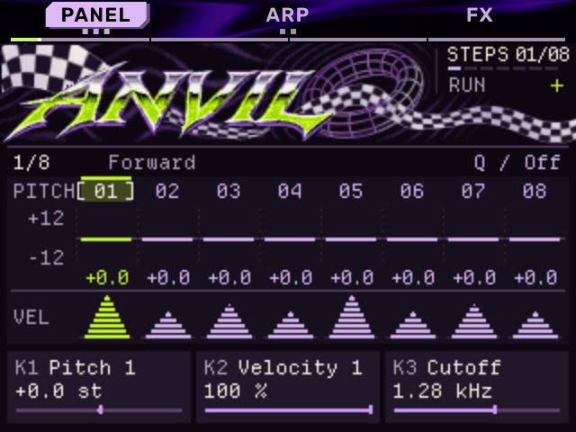
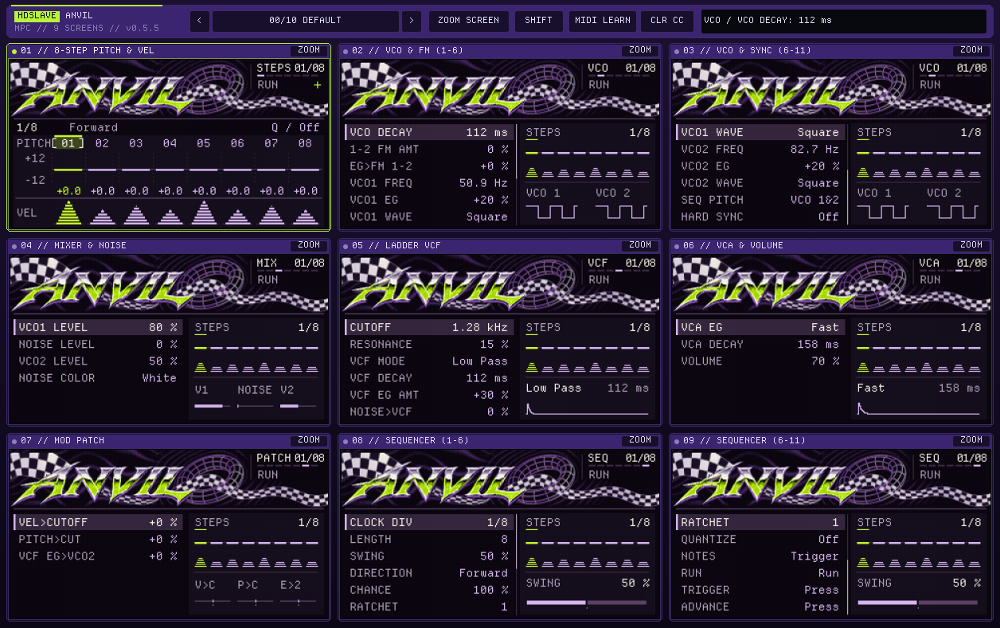
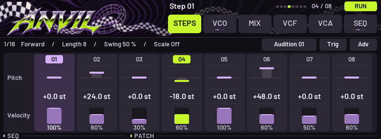

# hdslave Anvil

**An 8-step analog-style percussion synthesizer (DFAM / Edge panel & flow) as a CLAP plug-in for the Akai MPC Sample.**

<table>
  <tr>
    <th width="25%">MPC Sample</th>
    <th width="48%">macOS and Windows · CLAP</th>
    <th width="27%">SP-16 · freesp16</th>
  </tr>
  <tr>
    <td align="center"><a href="docs/anvil-screen.webp"></a></td>
    <td align="center"><a href="mac-clap/assets/desktop-preview.webp"></a></td>
    <td align="center"><a href="docs/sp16/steps.webp"></a></td>
  </tr>
</table>

> **Desktop CLAP version (macOS & Windows):** A separate desktop CLAP build with all MPC screens on one interactive panel lives in [**`mac-clap/`**](mac-clap/) (`cd mac-clap && ./install-macos.sh`). The SP-16 build is [below](#freesp16).

Built for the Akai MPC Sample running [Melodee](https://github.com/keremimo/melodee-sample) / [hdslaveOS](https://github.com/hdslave/hdslaveOS) (64-bit ARM Linux, Cortex-A55). Hosts list it as **hdslave Anvil** (id `com.hdslave.anvil`, version 0.8.0). It follows the front panel and normalled signal flow of the Moog DFAM and the Behringer Edge — dual VCOs with linear FM, hard sync, white/pink noise, overdriving mixer, and a 4-pole LP/HP ladder filter — without the patch bay, plus one new modulation control: **VCO EG > FM 1-2 Amt**.

The custom screen uses `melodee.screen/1` on Melodee 0.7 and hdslaveOS based on it. Open Edit on the plug-in track or select PANEL on Stage.

Its 8-step pitch and velocity sequencer (with variable Length and host swing) locks tightly to the host transport: steps fall on the beat grid while playing, stop on stop, and follow song jumps. Under **hdslaveOS**, Anvil draws its own live step-bar and velocity screen directly on the MPC Sample (see [The screen](#the-screen)).

## hdslave plug-in license

You may use these plug-ins to make, perform, record and sell music, including paid client work, without royalties or credit to hdslave. You may share complete, unchanged official releases for free with their notices intact. Selling the software, including it in a paid product or subscription, or distributing a modified version requires prior written permission from hdslave. Third-party components keep their own licenses. [Full plug-in license](LICENSE.txt).

## Signal flow

```
step PITCH ──► VCO 1 and/or VCO 2 (Seq Pitch Mod)        step VELOCITY ──► the peak of all three EGs
VCO EG ──► VCO 1 pitch (VCO 1 EG Amt), VCO 2 pitch (VCO 2 EG Amt), 1-2 FM depth (VCO EG > FM 1-2 Amt: new)
VCO 1 triangle ──linear FM──► VCO 2          VCO 1 ──hard sync──► VCO 2
VCO 1 + noise (white/pink) + VCO 2 ──► mixer (clips when hot)
  ──► 4-pole ladder, LP or HP (cutoff moved by VCF EG and by noise) ──► VCA (VCA EG) ──► Volume ──► out (stereo)
```

Every step triggers all three envelopes at its velocity. A softer step does not cut a louder tail still falling,
nor a louder step's attack still rising (the slow VCA attack under a fast pattern, or a Trigger on a step's frame):
the louder step reaches its full peak.

On the MPC it draws its own page on the screen (see [The screen](#the-screen)). While Run is on, the pads play the
steps; with Run off they play notes (see [The pads](#the-pads-midi-notes)).

Not yet run on the MPC itself: tested in hdslaveOS's own CLAP host code (`clap_check`) and this repository's tests.
The drum map and the pad banks (0.7.0) have not been tried on the MPC either.

0.6.2 hardens what a host can send — a missing or non-finite tempo reads as 120 and a sample rate that is no rate
as 48 kHz, a Play landing mid-step the same at every block size, a state or preset settling at once instead of
gliding, `reset` leaving a fresh engine, non-finite text and states from a newer version refused — with the sound
otherwise as it was (every fingerprint hash holds). 0.6.3 counts a press on the page by the frames rendered since
it, never by the clock: a press queued while the instrument slept still plays once when it wakes, whether the page
stayed open or was closed, and none survives a deactivation. The sound is again as it was.

0.6.4 adds the freesp16 page below. The MPC page is unchanged, and so is the sound on the MPC build
(every fingerprint hash holds). It has not been run on the MPC.

0.7.1 brings the refreshed SP-16 editor onto 0.7.0's engine, so one version runs on both instruments. On the MPC
the page and the sound are unchanged (every fingerprint hash holds, and the cost is 0.7.0's to the instruction).

0.8.0 adds fifteen factory presets that show off the FM after the ten there were, nine of them with the steps on
VCO 2 alone (see [Presets](#presets)). The engine is untouched: every earlier fingerprint hash holds and the cost is
0.7.1's to the instruction. The new presets have not been heard on the MPC.

## freesp16

A 32-bit ARM build for [freesp16](https://freesp16.github.io/) on the SP-16. freesp16 keeps its own screen chrome and its six encoders. Anvil draws the 780×285 body between them and names the six parameters for the lit tab (`org.sixteen.screen/1`). STEPS, VCO, MIX, VCF, VCA and SEQ are on screen. VCO and SEQ each have a second bank: tap the tab again.

The download is `hdslave-Anvil-freesp16-0.7.1.zip` in [release 0.7.1](https://github.com/hdslave/hdslave-Anvil-Synth/releases/tag/v0.7.1). Unzip it at the root of the USB stick freesp16 starts from. `Anvil.clap` then sits in `freesp16-data/freesp16/Plugins/`. On a track: TRACK TYPE, PLUGIN, SELECT PLUGIN, **hdslave Anvil**, OPEN UI.

The object is ARMv7-A, softfp, glibc 2.13, and it needs only `libm` and `libc`. The host tests pass on it under qemu-arm (0.7.1: 709,698 checks, `make sp16-test`), and the MPC build's fingerprint did not move. 0.6.4 was loaded on a unit on 2026-11-23 and it worked. 0.7.1, with the refreshed editor and the engine of 0.6.5 to 0.7.0, has not been run on a unit yet.

The SP-16 editor marks the selected step in violet and the playing step in lime. On STEPS, **SEQ** marks the selected step’s pitch and velocity on knobs 1–2. **PATCH** marks cutoff, resonance, filter decay and amp decay on knobs 3–6 for the whole patch. Drag a parameter card up or right to increase its value, or down or left to decrease it. Touching a card on VCO or SEQ also selects its encoder bank. The six hardware knobs can continue the edit from the displayed values.

Open a bank recording to see its controls during playback.

| Bank | SP-16 panel |
| --- | --- |
| STEPS | [Edit step pitch and velocity](docs/sp16/steps.webp) |
| VCO | [Oscillators](docs/sp16/vco.webp) · [FM and hard sync](docs/sp16/vco-fm.webp) |
| MIX | [Signal levels](docs/sp16/mix.webp) |
| VCF | [Filter controls](docs/sp16/vcf.webp) |
| VCA | [Amplifier and patch controls](docs/sp16/vca.webp) |
| SEQ | [Clock and groove](docs/sp16/seq.webp) · [Scale, notes and run](docs/sp16/seq-notes.webp) |

## Controls

The panel's names, in the order Melodee's Edit page lists them (three to a page).

| Anvil | DFAM | Edge | Range |
|---|---|---|---|
| VCO Decay | VCO DECAY | EG (VCO 1&2) DECAY | 10 ms – 10 s (time to -60 dB) |
| 1-2 FM Amt | 1→2 FM AMOUNT | 1-2 FM AMT | 0 – 100 %, linear FM from VCO 1's triangle, index 3 at 100 % |
| **VCO EG > FM 1-2 Amt** | — (new) | — (new) | ±100 %: the VCO EG added to the FM amount |
| VCO 1 Freq | VCO 1 FREQUENCY | FREQUENCY | 4.5 Hz – 4.6 kHz, 10 octaves |
| VCO 1 EG Amt | VCO 1 EG AMOUNT | ENVELOPE | ±8 octaves at full velocity |
| VCO 1 Wave | VCO 1 WAVE | SHAPE | Square / Triangle |
| VCO 2 Freq, VCO 2 EG Amt, VCO 2 Wave | VCO 2's | VCO 2's | as VCO 1's |
| Seq Pitch Mod | SEQ PITCH MOD | SEQ PITCH MOD | VCO 1&2 / Off / VCO 2 |
| Hard Sync | HARD SYNC | HARD SYNC | Off / On (VCO 2 to VCO 1) |
| Noise Color | — | NOISE COLOR | White / Pink |
| VCO 1 Level, Noise Level, VCO 2 Level | mixer levels | mixer levels | 0 – 100 %; together they clip when hot |
| Cutoff | CUTOFF | CUTOFF | 20 Hz – 20 kHz |
| Resonance | RESONANCE | RESONANCE | LP self-oscillates from about 80 %; HP rings but stays below |
| VCF Mode | VCF HP/LP | VCF SELECT | Low Pass / High Pass (both 4-pole) |
| VCF Decay | VCF DECAY | DECAY | 10 ms – 10 s |
| VCF EG Amt | VCF EG AMOUNT | ENVELOPE | ±8 octaves at full velocity |
| Noise/VCF Mod | NOISE / VCF MOD | NOISE/VCF MOD | 0 – 4 octaves of noise on the cutoff |
| VCA EG | VCA EG FAST/SLOW | VCA MODE | Fast (1 ms attack) / Slow (100 ms) |
| VCA Decay | VCA DECAY | DECAY | 10 ms – 10 s |
| Volume | VOLUME | VOLUME | 0 – 100 % |
| Vel > Cutoff | — (patch: VELOCITY to VCF MOD) | — (patch) | ±100 %: a step's velocity moves the cutoff, up to 4 octaves at full velocity |
| Pitch > Cutoff | — (patch: PITCH to VCF MOD) | — (patch) | ±100 %: a step's pitch moves the cutoff as far as it moves the VCOs at 100 % (key tracking) |
| VCF EG > VCO 2 | — (patch: VCF EG to VCO 2 CV) | — (patch) | ±100 %: the VCF EG bends VCO 2's pitch, up to 8 octaves at full velocity |
| Clock Div | TEMPO (replaced) | SCALE | 1/2 … 1/64 of the host's beat, with triplets |
| Length | — (patch cables) | — (patch cables) | 1 – 8 steps: the sequence plays steps 1 to Length, then step 1 again (on the panels, a cable from a step's trigger to Reset) |
| Swing | — | — | 50 – 75 %: the second step of each pair comes late, at that share of the pair, as an MPC's swing does (66 %: a triplet shuffle) |
| Direction | — | — | Forward / Backward (1, Length … 2) / Ping-Pong (1 … Length … 2) / Random. Random follows the song's place: the same steps when the same part plays again |
| Chance | — | — | 0 – 100 %: how likely each step is to sound (a silent step still moves the sequence); also the same for the same place in the song |
| Ratchet | — | — | 1 – 4 hits a step, spread evenly over it |
| Run | RUN/STOP | PLAY/STOP | Stop / Run. Also what the pads do: with Run on they play the steps ([The pads](#the-pads-midi-notes)) |
| Trigger | TRIGGER | TRIGGER | plays the current step without moving |
| Advance | ADVANCE | ADVANCE | moves one step without playing (in the Direction set) |
| Notes | — | — | What a MIDI note does while Run is off: **Pitch** (the default) plays the voice at the key's pitch, chromatically; **Steps** plays the step the key names, as Run on does. Before 0.6.0 Pitch was **Trigger** (a note played the step the sequence was on); saved projects keep the setting, which now means Pitch |
| Quantize | — | — | Off / Semitones / Major / Minor / Minor Pent / Phrygian / Fifths / Octaves: the steps' Pitch snaps to semitones, or to the nearest note of the scale counted from the VCOs' own pitch (a step at 0 plays the Freq knobs as they are). The Pitch knobs then read as the note they play. Off: any pitch, as on the panel |
| Pitch 1–8 | PITCH 1–8 | PITCH | ±5 octaves |
| Velocity 1–8 | VELOCITY 1–8 | VEL | 0 – 100 % |

### The pads (MIDI notes)

Anvil carries a drum map in the plug-in (the JSON hdslaveOS reads from a plug-in's library), so hdslaveOS plays a
plug-in track on it as Drums: pads A01–A16 send notes 36–51 whatever the track's octave, key or scale, and the Keys
page names them **Step 1** … **Step 8**, then **Step 1** … **Step 8** again for pads 9–16. hdslaveOS's − / + then
move the pad bank instead of the octave: bank B sends 52–67, C 68–83, D 84–99.

Where the pads are steps (Run on, or Notes: Steps), Anvil reads every key as a pad and a bank: pad slot (key − 36)
mod 16 and bank ⌊(key − 36) / 16⌋, held to −2 … +3 (banks A–D are 0 to +3 octaves, keys above 99 play as bank D, and
below A, 20–35 and 4–19, are banks −1 and −2). **Every bank plays the same 16 step pads, an octave up a bank.** − / +
never re-map the step pads and never silence them. Where the keys play notes (Run off, Notes: Pitch), every key plays
its own pitch, as before 0.7.0.

- **Run on (the default): pads 1–16 play steps.** Pads 1–8 (notes 36–43) are steps 1–8, pads 9–16 (44–51) steps 1–8
  again. A pad of another bank plays its bank-A pad's step an octave up a bank (bank B's pad 1, note 52, is step 1 an
  octave up, bank D's three octaves up; after Quantize, so it stays in the scale), or down below A, within a step's ±5
  octaves. A pad plays its
  step at once, as the sequencer plays that
  step: its Pitch (as Quantize plays it), its Velocity times the pad's, through every route the step takes. It plays
  even where the sequence would leave the step silent (Chance), and with the transport stopped or playing. The
  sequence does not move: the next step is the one it would have been. The pad's pitch (and its bank's octave) holds
  until the sequence's next step (or Trigger, or Advance) replaces it.
- **Run off: the pads play notes** (Notes: Pitch, the default), chromatically, exactly as before 0.7.0. A key plays
  the voice as a step of its own: its Pitch is the key's distance from pad 1's note (36, which plays the Freq knobs as
  they are; pads 1–16 run from there to 15 semitones above it, and keys below 36 lower), its velocity the note's,
  through the same routes (Seq Pitch Mod, Pitch > Cutoff, Vel > Cutoff, VCF EG > VCO 2), not snapped by Quantize. The
  pitch stops at a step's ±5 octaves (key 96; higher keys play as 96). The bank does not re-map it: bank B's pad 1
  (note 52) plays 16 semitones above pad 1, as an external keyboard's or a saved project's note 52 always did. The
  sequence does not move. With Notes: Steps the pads play the steps, as with Run on (Pad Kit's drums: another bank
  plays the same drum an octave up or down).
- **What 0.7.0 replaced.** To 0.6.8 a key with Run on played step (key − 36) mod 8, so a key outside 36–51 picked
  a step by that count: after hdslaveOS's octave − / + (12 keys), every pad landed four steps on (hdslaveOS issue 1).
  Step pads now follow the bank rule above. Chromatic play (Run off, Notes: Pitch) is unchanged, to the bit. Anvil
  has no other way to transpose the sequence from the keys.
- Two pads on one frame (hdslaveOS sends a block's MIDI on its first frame) play the louder, whole; on a tie the later.
  A pad on a step's own frame is such a pair too. A pad pressed again plays again; a note-off changes nothing: each hit
  rings out, as a step does.
- A **choke** (a CLAP note choke, or a host's choke group) and MIDI's **All Sound Off** (CC 120 at 0, on any channel)
  stop the hit that sounds: the choke of the key that played it, or key −1 / All Sound Off, whatever sounds; the output
  fades out in 1.5 ms, without a click; the hit's envelopes, and what the output's decimator still holds of it, are
  cleared with it, and its Ratchet hits still to come do not play. A hit inside the fade (a pad pressed straight after
  a silence) waits for the fade's end, 1.5 ms at most, and plays whole from silence: the choke always finishes and the
  gain never steps (to 0.6.5 the fade went on over the hit and ended in a click; 0.6.6 turned the fade back up, which
  left the choked hit ringing under a softer one). A choke or All Sound Off that arrives while nothing is heard (the
  VCA closed) is done at once and leaves the next hit whole (to 0.6.5 it faded that hit too). It still ends the
  envelopes that run on under the closed VCA (the VCO's, the VCF's), so the next hit starts from them at rest. With
  nothing running at all, the next hit is as it would be without the choke, a knob turned on its frame taken at once.
  hdslaveOS
  sends them when it silences the track (its note chokes for the keys played), not on Stop. A sequencer step, Trigger's and the page's
  have no key: a key's choke leaves them, key −1 and All Sound Off stop them. Reset All Controllers (CC 121) and All
  Notes Off (CC 123) do nothing (no key is held, there is no pedal), and no controller is a parameter. The sequence's
  place and Run do not move.
- Trigger (the button) still plays the step the sequence is on, and the STEPS page's Push the step it picks.

### The new control

**VCO EG > FM 1-2 Amt** adds the VCO EG to the 1-2 FM amount, as patching the VCO EG output into the FM amount's CV
input would. Positive: FM is deepest on the hit and fades with the VCO EG (a bright, metallic attack that settles).
Negative, with 1-2 FM Amt up: the hit starts clean and the FM grows as the envelope falls. The sum stays within
0 – 100 %. The VCO EG peaks at each step's velocity, so louder steps get more of it.

## Presets

Twenty-five factory presets, inside the plug-in: Melodee lists them on the plug-in's PRESETS page (any host with
CLAP preset discovery does). A preset sets every control, Clock Div and the eight steps too; Default puts everything
back.

The fifteen added in 0.8.0, after the first ten, show off the 1-2 FM. VCO 1's triangle modulates VCO 2's frequency, so VCO 2's pitch
against VCO 1's is the FM ratio and VCO 2's level is how much of it you hear. With **Seq Pitch Mod on VCO 2** the
steps move VCO 2 alone: the note stays where VCO 1 is and every step is a new ratio, a new timbre. The growls add what
moves inside a hit: **VCO EG > FM 1-2 Amt** below zero lets the FM grow as the VCO EG falls, **VCF EG > VCO 2** bends
the ratio, and each step's velocity sets how far all of it goes. Growl Morph, Sync Snarl, Gut Wobble, Stutter Growl,
Churn Bass, Rust Scream, Ratio Steps, Tidal Morph and Metal Hats play that way.

| Preset | What it is |
|---|---|
| Default | The panel as it opens: both VCOs into the low pass, 1/8 steps |
| Kick | VCO 1's triangle swept down by a fast VCO EG, a little noise, 1/8 steps |
| FM Perc | VCO 2 frequency-modulated, its depth riding the VCO EG (the new control at +70 %), a stepped pitch line in 1/16 |
| Sync Bass | VCO 2 hard-synced and swept, a resonant low pass, the slow VCA attack, a pitch line in 1/16 |
| Noise Hat | White noise through the high pass, accented on the odd 1/16 steps |
| Acid Steps | A bassline in a key: Quantize Minor Pent, 7 steps swung (58 %), the cutoff following each step's pitch and velocity (Pitch > Cutoff, Vel > Cutoff) |
| Ratchet Snare | Noise and a swept triangle, every eighth hit twice (Ratchet 2), the backbeat loud, Chance leaving out a few ghost notes |
| Random Zap | Laser zaps in a Random order: VCO 2 swept down, FM riding the VCO EG, VCF EG > VCO 2, steps a fifth or an octave apart (Quantize Fifths), some left out (Chance) |
| Ping-Pong Toms | Six toms down a minor scale and back up (Ping-Pong, Length 6, Quantize Minor), swung |
| Pad Kit | Eight drums on pads 1–8 (notes 36–43, and again on pads 9–16), low to high, the higher brighter (Pitch > Cutoff); with the transport running it plays them as a pattern too. Run: Stop for the pads alone: its Notes: Steps keeps the eight drums on the pads |
| Growl Morph | The steps move VCO 2 alone (Seq Pitch Mod: VCO 2), so the bass note holds on VCO 1 while each step sets a new FM ratio; inside each hit the FM grows (VCO EG > FM negative), VCO 2 rises (VCF EG > VCO 2 negative) and the filter opens (VCF EG negative), with noise roughing the cutoff |
| Sync Snarl | VCO 2 hard-synced to VCO 1 with the steps on VCO 2 alone: the pitch stays, each step moves the formant, and the VCO and VCF EGs sweep it down inside the hit; FM from VCO 1 on top |
| Gut Wobble | A slow growl in eighths: each step VCO 2 alone a fifth or an octave away (Quantize Fifths), the FM blooming as the VCO EG falls, VCO 2 rising, the slow VCA swelling under a closing filter |
| Stutter Growl | Every eighth three times (Ratchet 3), a new FM ratio each step (VCO 2 alone), each stutter sweeping VCO 2 down, the FM near its harshest, Chance dropping a step now and then |
| Churn Bass | Quarter notes on a held bass: VCO 2 a hair off VCO 1, each step putting it a little further off (VCO 2 alone, unquantized), so the FM sidebands churn at a different speed every beat |
| Rust Scream | A screaming lead: VCO 2 three times VCO 1 and deeply modulated, rising into each note (VCF EG > VCO 2 negative) through a resonant filter, the steps on VCO 2 alone in a minor key, in a random order |
| Ratio Steps | FM laid bare: VCO 1 modulates VCO 2, both triangles, and the steps walk VCO 2 alone up and down the ratios 1, 1.5, 2, 3, 4 (Quantize Fifths): the note holds while the tone steps; each hit brightest on the attack |
| FM Pluck Bass | A bassline in a minor key: the two VCOs in unison (the steps on both), VCO 2 modulated hard on the attack and settling, VCO 1 under it as a sub, swung |
| Tidal Morph | A drone in half notes: VCO 1 holds, each step sets VCO 2 (alone, unquantized) to a new ratio, and over each long note the FM grows while the slow VCA and filter swell and fall |
| Glass Bells | Bells in a minor pentatonic: VCO 2 the note, VCO 1 below it at an unrelated ratio (1 : 1.41) so the partials ring inharmonic, the FM deep on the strike and fading (the steps move both VCOs, keeping the ratio) |
| FM Kick | Four on the floor with a pickup: VCO 2 a triangle swept down from about 600 Hz, VCO 1 below it modulating it on the attack only (a knock that is gone with the sweep); the steps leave the pitch alone (Seq Pitch Mod Off) |
| FM Clang | A snare from metal: VCO 2 modulated at an inharmonic ratio, a short drop in pitch, noise for the snap (and roughing the cutoff), on the backbeat with ghost notes |
| FM Toms | Six toms down a minor scale and back up (Ping-Pong, Length 6), VCO 2 a fifth over VCO 1 and modulated by it on the strike, both swept down a little, swung |
| Metal Hats | Hi-hats from FM alone: two high square VCOs at an inharmonic ratio, the FM at full depth, a little noise, through the high pass; each step tints VCO 2 a little (VCO 2 alone), accents on the beat |
| FM Pad Kit | Eight FM drums on pads 1-8 (Notes: Steps; again on pads 9-16), from a kick up to metal, the higher the brighter (Pitch > Cutoff), each struck with an FM knock; with the transport running it plays them as a pattern too (Run: Stop for the pads alone) |

They are the patches the demo renders play: the tests load each preset and check it gives the same values and the
same samples as the demo's list. The 0.8.0 presets' levels were set by measurement (BS.1770 loudness of the 8-second
demos: about −24 to −28 LUFS, Metal Hats −30); nobody has listened to them yet. The list only grows: the first ten
are as they were, and a released preset's key always loads the same preset.

## The screen

In hdslaveOS (hdslave's Melodee fork), Anvil draws its own page in place of the parameter list:

- **STEPS**, the panel's sequencer: the eight steps' pitch (bars from a middle line, full height ±2.5 octaves) and
  velocity, each pitch read as Quantize plays it, the step playing lit, steps past Length dimmed. The wheel picks a
  step (framed), Push plays it as its pad does while Run is on (with Run off too), K1 and K2 turn its Pitch and
  Velocity, K3 the Cutoff.
- **VCO, MIX, VCF, VCA, PATCH, SEQ**: the panel's knobs by section, the steps beside them.

A host that asks for `org.sixteen.screen/1` gets a different page, 780×285, and names six parameters for its own
encoders. STEPS puts the picked step's Pitch and Velocity on K1 and K2, then Cutoff, Resonance, VCF Decay and VCA
Decay. VCO and SEQ each have two banks (tap the tab again, or the other bank). Trigger and Advance are buttons on
the STEPS page, not knobs. The wheel moves the picked step; Push plays it. The MPC page above is what hdslaveOS
asks for. Any other host asks for neither.

On a list the controls are hdslave Machine's: the wheel moves a row; Push edits it (the wheel then changes it: a
choice a step, a knob 1/128, 1/1024 with Shift; Push again leaves), or presses a button (Trigger, Advance); Minus /
Plus change group (while editing, a choice or a whole number a step, a knob a sixteenth of its range); K1-K3 turn the cursor's row and the two under it, with
Melodee's takeover (a hollow mark shows where to move a pot). Hold Shift for these. Another host never asks for the
page.

## Clocking from the host

- A step starts on every multiple of Clock Div counted from the song's top, while the host plays (swung: every second
  one later by Swing). Play from the top starts on step 1, on its first frame; each later step lands on its frame. A
  Play or a jump places the sequence by the song's place: the clock's number from the top, counted round Length.
- Stop stops the sequence (sounds ring out). Play again starts from where the song is.
- A jump, or a loop going round, lines the sequence up with the song's place again. A Play or jump landing just past a
  step's start (within a block) plays that step at once.
- A loop that wraps inside a block is told only at the next block (Melodee tells the song's place at its own blocks,
  even when it plays a plug-in in smaller parts), so the steps run on to the loop's end, which is its start: the step
  played there stands for the downbeat. When the host tells, the sequence lines up with the song and goes on from
  there, and the downbeat is not played twice; one the loop's end left silent (Chance) plays then, at most a block
  late (2.7 ms at 128 frames).
- A tempo change inside a block moves the host's place a few frames from where the steps counted: followed as it is,
  no step played twice, a step passed played at once.
- So does a place a little off its line, either way, by up to a 64th note: hdslaveOS works the place out from its
  ticks, so a swung tick, a tick on a block's edge or MTC's trim puts it up to 0.0021 of a quarter off from block to
  block, and a plug-in two tracks play is run twice a block (its next block's first call told a block back). A step
  back holds the steps already played until the song is past them again. Before 0.6.8 a step back of more than the
  call's own frames counted as a jump: with the calls in parts, at slow tempos or run twice a block, a step could play
  twice or be lost (at 40 BPM with the place up to 0.002 of a quarter off, 57 of 192 steps of 1/32 played twice).
  A move of more than a 64th note is a jump, as before (exactly a 64th, as hdslaveOS has it, is not), and so is one on
  past two clocks (Swing 75 at 1/64): the step the song landed on plays, not the two passed on one frame.
- Clock Div changed while playing: the steps count on the new grid from there; one due on that frame plays. While the
  place is held behind the steps played (above), they count from where the steps got to, so none plays again.
- Run off: the host plays but the sequence holds its step and stays silent; Advance and Trigger work as on the panel.
  Run on again plays the step it is on at once and goes on from there; switched on on a step's own frame (with Play,
  or on a later step), that step plays, once.
- Added while the song plays (its first block already playing): it starts where the song is, as any Play does. Before
  0.5.3 a new instance's own defaults counted as a press of Run, so a first block that already played sounded steps 1
  and 2 at once and ran a step ahead until the next Play from a stop.
- In Melodee, keep the plug-in's **TRANSPORT** on (the default): with it off the plug-in never hears Play.

## Where values were inferred

The DFAM manual documents the routing and several ranges (envelope attacks, VCF decay 10 ms – 10 s, cutoff 20 Hz –
20 kHz, step pitch ±5 V). It does not give these, so they are chosen to match what is documented:

- VCO range: 10 octaves, centred so a deep bass sits a little left of the middle.
- VCO and VCA decay ranges: the same as the VCF's (the same circuit).
- EG depths: ±8 octaves (the EG's 8 V into 1 V/octave).
- FM depth: index 3 at full (VCO 2 swings by 3 times its frequency; it stops at 0 Hz rather than going through zero).
- Noise/VCF Mod: up to 4 octaves.
- Velocity also lengthens the decays, by up to ±10 % ("slightly longer" in the manual).

Left out on purpose: the patch bay and the external audio input, and the panel's audio-rate tempo (the clock is the
host's; 1/64 is the fastest step).

## Cost

One voice, run at twice the host's rate (so FM and sync stay clean) and filtered back down with a half-band FIR.
Instructions a 128-frame block takes, from `tools/bench.sh` (callgrind):

| Case | Instructions | Share of one A55 core at 1 instruction a cycle |
|---|---|---|
| Everything busy (FM, its envelope, sync, pink noise on the cutoff, resonance, the VCA never closing) | about 92,900 | 1.9 % |
| A short percussive pattern | about 86,400 | 1.8 % |
| Stopped | about 600 | 0.01 % |

While the VCA is closed between hits the oscillators and filter are skipped. The voice's two samples a frame, and the
synced oscillator's step, are compiled into the frame's loop rather than called (a fifth fewer instructions than
before, the same output to the bit). The real share on the MPC depends on
how many instructions the A55 retires a cycle on this code; measure it with Melodee's plug-in load figure.

## Build and test

Needs Docker with a Linux arm64 context (Melodee's `colima-melodee` and its `melodee-builder` image by default).

```sh
./build.sh          # build/Anvil.clap, then the tests (tests/host.cpp), the sound's fingerprint and demo renders build/demo-*.wav
./build.sh sanitize # the tests and the fingerprint's scenarios under AddressSanitizer and UBSan
./build.sh bench    # build/bench
tools/bench.sh      # instruction counts (Melodee's melodee-profiler image)
```

The SP-16 object and its tests run in freesp16's toolchain image, `sp16-toolchain:gcc11-egl` (GCC 11, glibc 2.13
sysroot, qemu-arm):

```sh
docker --context colima-melodee run --rm -v "$PWD:/work" -w /work sp16-toolchain:gcc11-egl make sp16-test
```

That builds `build/Anvil-sp16.clap`, checks its glibc symbol versions and runs `tests/host.cpp` on it as a Cortex-A9,
with the pictures of both pages in `build/sp16/`.

The tests load the plug-in through the CLAP API and check: description and ports; every parameter's range, text and
default; state save and load; the presets as preset discovery lists them and preset-load loads them; step timing to the frame at 44.1, 48 and 96 kHz and two tempos; stop, restart, jumps,
a host without a song position; a loop wrapping inside a block and told a block late (one hit on the downbeat, not
two; a downbeat the loop's end left silent still played, in whole blocks and in Melodee's smaller parts), a tempo
change inside a block, the place off its line (up to 0.002 of a quarter either way, also in parts; swing 60's ticks;
run twice a block; at 127 and 40 BPM: each step once, near its place) and moved back under and over a 64th note,
Clock Div changed on a downbeat, a button pressed through a flush and one stamped past its
block; the same output whatever the block size (1, 37,
128, 4096 frames); Trigger, Advance, Run and MIDI notes; Length (a cycle of 3, Advance wrapping in it) and Swing (66 and
75 %, and a jump between a step's grid line and its late clock); Notes: Steps (notes 36 to 39 and 44, a softer note);
the pads (with Run on, each of notes 36 to 51 the same, to the bit, as Trigger on its step, with the transport stopped,
Quantize, Chance 0 and the routes on, and by the pitch heard, also while the host plays; the sequence not moved, the
next step's pitch its own; a pad on Play's frame, softer, tied or louder; two pads on one frame, either order and tied;
on/on/off of one pad; MIDI note-ons, velocity 0 and a silence storm with nothing sounding; with Run off, Notes: Pitch
playing keys chromatically by the pitch heard (pad 1's note 36 at the knobs, a key a semitone, not snapped by Quantize,
the ±5 octaves of a step's Pitch; keys 52, 68 and 84 at their own pitch), and to the bit as a step of their own
through every route, two keys on one frame,
Trigger and Advance afterwards; the pad banks with Run on (keys 52, 68, 84, 60, 20 and others: the bank-A pad's
step by the pitch heard, an octave a bank, bank D three, with Quantize Off and Octaves, at the same level; keys past
the banks to the bit as the last bank's; the octave gone with the next Trigger or Advance); the drum map in the binary (one, 16 pads on notes 36–51,
named); Notes: Steps and Pad Kit with Run off; the page's Push with Run off; the same output in
blocks of 1, 37, 128 and 4096 frames); a choke stopping the key's hit (and not another key's, nor the sequencer's: key
−1 and All Sound Off stop that), All Sound Off on any channel, Reset All Controllers and All Notes Off changing
nothing, the Ratchet hits after a choke gone, a choke and a hit on one frame in event order, a hit inside the fade
(sounding once the fade is out, with no step in the gain at 0 to 71 frames in, a softer one at its own level, a choke
before it sounds stopping it), nothing of the choked hit after the fade (a tone and noise, a choke and All Sound Off),
a choke or All Sound Off while nothing is heard (the VCO's envelope still running too) leaving the next hit whole,
and with nothing running at all to the bit as without it (Volume, Resonance or VCO 2 Level turned on its frame and the
hit 16 frames on), and
the same output in blocks of 1, 37, 128 and 4096 frames with chokes in it;
each Direction (the order read back from the steps' levels; Random the same twice); Chance (0 %, 50 % the same twice);
Quantize (each scale's note from the pitch heard; the Pitch texts by it, and the host asked to read them again); the
screen's page (it draws, picks and plays a step, its controls set the values the host then hears, its buttons press;
pictures in `build/screen-*.png`);
Ratchet (three hits a step, evenly spaced); the patch routings (each the same sound as turning Cutoff as far, from the
second step; at 0 they change nothing; VCF EG > VCO 2 bending VCO 2); velocity and tails; a softer step or note in a
louder one's attack (on its frame, half a millisecond later, and inside the slow VCA attack at 1/32) leaving its
peak, to the bit; a first block that already plays (at the song's top, mid-step, on a later step) sounding as one
that waited a stopped block, to the bit, and Run switched on on a step's frame playing it once; VCO pitch, step pitch on each Seq Pitch
Mod setting; the new FM control both ways; and finite, bounded output at 60 random and extreme settings.

`tests/fingerprint.cpp` then renders 78 fixed scenarios (each preset, the bench's patches, 24 random patches with the
buttons, MIDI and knobs moving, other block sizes and rates, stop and jumps, Length and Swing, each Direction with
Chance and Ratchet, the patch routings, notes playing steps, a loop wrapping inside a block in whole blocks and in
parts, the pads playing steps with the transport stopped and playing, keys with Run off) and hashes every output
sample's bits
against `tests/fingerprint.txt`: work meant to keep the sound, such as a speed-up, must leave every hash as it is. A
change meant to change the sound updates them with `make fingerprint-update` (run inside the build image). The
hashes hold for Melodee's build image and these compiler flags.

## Install

Copy `build/Anvil.clap` to `Melodee/Plugins/hdslave/hdslave Anvil.clap` on the card (or the staged card's
folder), then pick it on an empty track: Stage, Plugin, hdslave, hdslave Anvil. It needs only libc and libm, glibc 2.35 or
newer (the MPC has 2.39).

## Credits

- The screen's type: Departure Mono, copyright 2022–2024 Helena Zhang, SIL Open Font License 1.1
  (`licenses/OFL-departure-mono.txt`); its glyphs are rasterized into `src/ui/font.h`.
- The screen extension's header, `src/melodee_screen.h`, is Melodee's (`melodee.screen/1`), MIT.
- CLAP headers: MIT license, `third_party/clap/LICENSE`.
